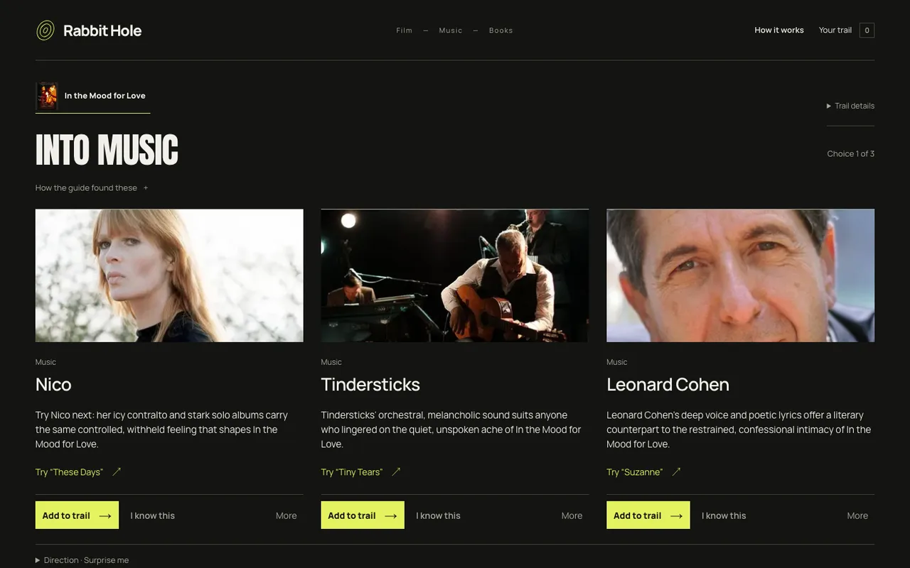
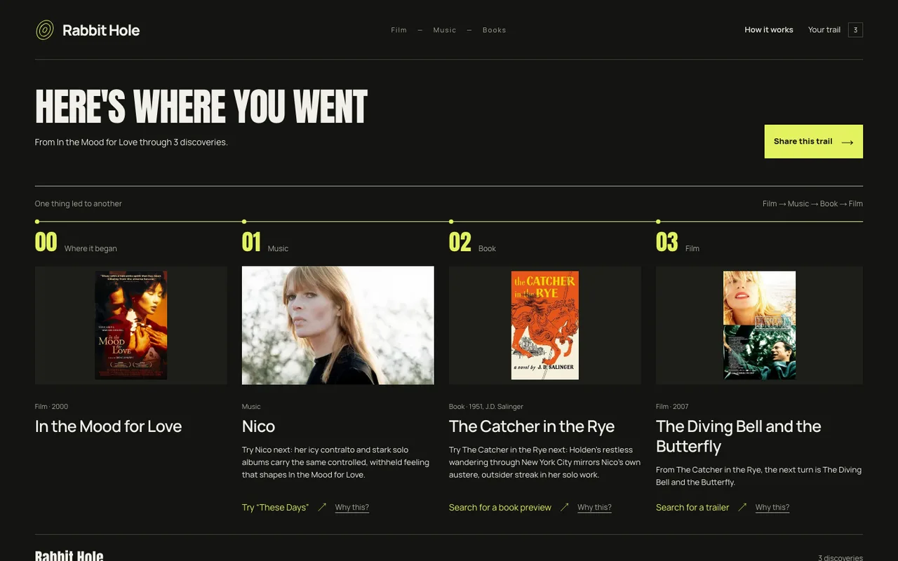

# Rabbit Hole

Follow your taste through three unexpected discoveries in film, music and books, then share a trail someone else can branch from.



**Qloo finds the connections. Haiku chooses the next move.** Qloo resolves your starting point and retrieves cross-category recommendations with directed affinity evidence. A bounded Claude Haiku agent calls tools, reads those results and chooses the next medium and discoveries. Each door explains its connection; “Why this?” exposes the source. Qloo affinity is evidence of shared taste, not a promise you'll enjoy something.

Finish after one to three discoveries, save an unlisted trail and let a friend take a different turn—no account needed.

## Run locally

Requires Bun 1.4+; Node.js 24 is supported for development tools.

```sh
bun install --frozen-lockfile
cp .env.example .env.local
bun run dev
```

Open [localhost:3000](http://localhost:3000). Blank provider keys run a labelled synthetic example. To use live discovery, fill `QLOO_API_KEY` and `ANTHROPIC_API_KEY`; the supported model defaults to `claude-haiku-5-5`. All variables are listed in [.env.example](.env.example). Secrets stay server-side.

Without services, local state lives in memory and resets on restart. `DATABASE_URL` selects Postgres (run `bun run db:migrate` first); otherwise `REDIS_URL` selects durable Valkey. `VALKEY_PREFIX` scopes KV keys. A missing Anthropic key selects the disclosed deterministic guide; live provider failures never silently become synthetic data.

```sh
bun run typecheck
bun run lint
bun run test
bun --bun next build
bun --bun next start
```

A local production server needs `APP_ORIGIN=http://localhost:3000` and `ALLOW_MEMORY_STORE=1` if no services are configured. To run the offline browser suite after building: `bun run test:browser -- --workers=2` with the pinned Playwright Chromium headless shell available. Live tests are opt-in and consume provider quota.

## Deploy on ShipTiffin

[tiffin.config.ts](tiffin.config.ts) declares project `rabbit-hole`, one Next.js `web` app, a Bun build and a database release migration. ShipTiffin supplies Postgres and Valkey automatically, runs `bun --bun next start`, and adds its Next.js adapter. No extra services or custom adapter are needed.

Configure `QLOO_API_KEY`, `ANTHROPIC_API_KEY`, `SESSION_SECRET` and `SHARE_TOKEN_SECRET` as secrets; use distinct random signing secrets of at least 32 characters. Set `APP_ORIGIN` to the public HTTPS URL and configure the confirmed Qloo allocation. Run `tiffin plan`, apply the reviewed plan, then run `tiffin deploy`. See [deployment setup](docs/deployment.md) for the exact variables, quota ledger and optional opening samples. Never deploy `.env.local` or `.cache/`.

The agent is limited to four model steps, two Qloo Insights operations and six HTTP attempts per run, with $3/day and $25 cumulative model reservation caps by default. Shared trails expire after 30 days; anyone with a link can read it. Editing belongs to the original browser cookie.



## Licence

[MIT](LICENSE) © 2026 Bilal Tahir. Third-party dependencies and fonts retain their own licences; font notices are in `public/fonts/`. Qloo data and third-party artwork are not covered by the code licence.
