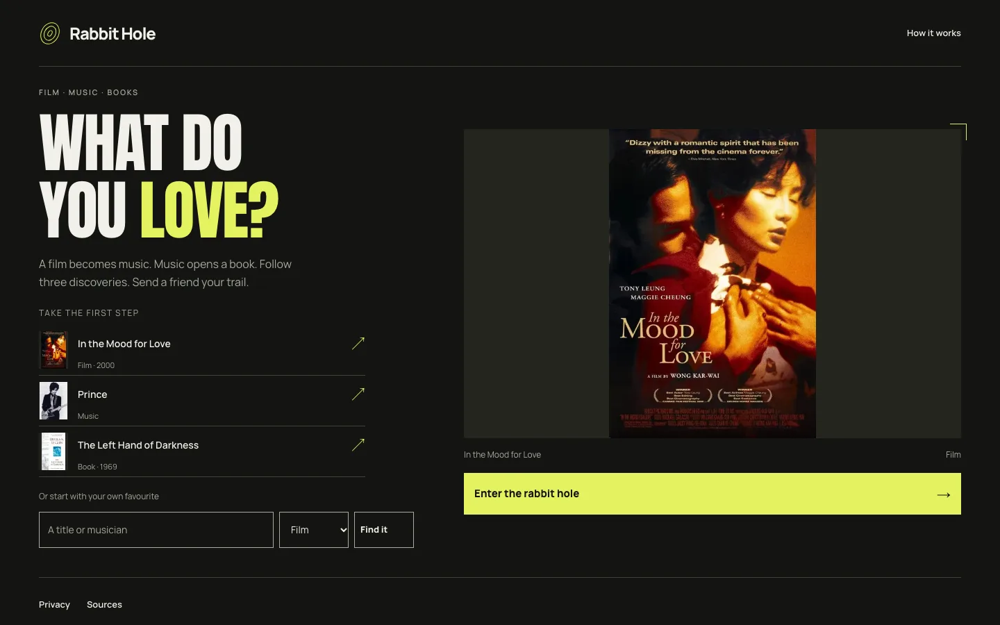
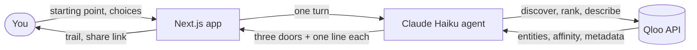

# Rabbit Hole

Start with a film, musician or book you love and follow your taste through three discoveries in other media.

**[Try it live → https://rabbit-hole.shiptiffin.app](https://rabbit-hole.shiptiffin.app)**

Built for the [Qloo Agentic Hackathon 2026](https://qloo.devpost.com/).



## How it works

1. **Pick a starting point.** Choose one of the samples or search for your own film, musician or book, then confirm which one you meant.
2. **Choose a door, three times.** Each turn the guide moves to another medium and offers three discoveries, each with one sentence on why it follows from where you are and one concrete thing to try. Mark anything you already know and it is replaced.
3. **Send the trail.** The finished trail becomes a share card and an unlisted link. A friend can read it, then keep the beginning and take a different turn without an account.


## Qloo and the agent



**Qloo decides what can appear.** It resolves your starting point to a real entity (`/search`), finds cross-domain recommendations from it (`/v2/insights` with `filter.type`, `signal.interests.entities`, exclusions, a popularity cap for "less obvious" and a content-rating filter), and reranks those candidates against any favourites you saved. The order and the candidates come from Qloo; the app never invents a destination.

**The agent decides how to use it.** A bounded Claude Haiku agent calls those Qloo operations as tools, reads what comes back, picks the next medium, tries another one when a query comes back empty, and writes the one-line connection for each door from the facts it was given. "Why this?" on every door shows the Qloo evidence behind it, and "Agent steps" shows what the agent did.

Without Qloo there would be nothing to choose from: the agent cannot add titles of its own. [/compare](https://rabbit-hole.shiptiffin.app/compare) shows five saved starting points, with Qloo's results next to a fixed-order baseline.


## Tech stack

- Next.js 16 (App Router, Cache Components) and React 19, running on Bun
- Claude Haiku 5.5 through the AI SDK and `@ai-sdk/anthropic`, with prompt caching
- Qloo Insights, Search and Entities APIs through a small typed client with caching and rate pacing
- Postgres for sessions, trails, shares and limits; Valkey for Qloo caches and the warmed samples
- Vitest and Playwright (headless Chromium) for tests

The agent is capped at four model steps, two Qloo Insights operations and six HTTP attempts per turn, with daily and total spending limits. Shared trails expire after 30 days.

## Run locally

Requires Bun 1.4+.

```sh
bun install --frozen-lockfile
cp .env.example .env.local
bun run dev
```

Open [localhost:3000](http://localhost:3000). With blank provider keys the app runs a clearly labelled synthetic example and makes no external calls. For live discovery, set `QLOO_API_KEY` and `ANTHROPIC_API_KEY` in `.env.local`. Without `DATABASE_URL` or `REDIS_URL`, state lives in memory and resets on restart.

```sh
bun run typecheck && bun run lint && bun run test
bun --bun next build
APP_ORIGIN=http://localhost:3000 ALLOW_MEMORY_STORE=1 bun --bun next start
bun run test:browser   # after a build; uses the synthetic example
```

## Deploy on ShipTiffin

[tiffin.config.ts](tiffin.config.ts) declares one Next.js app with a Bun build and a `bun run release` step. ShipTiffin provides Postgres and Valkey. Set four secrets by name, then deploy:

- `QLOO_API_KEY`
- `ANTHROPIC_API_KEY`
- `SESSION_SECRET` (random, at least 32 characters)
- `APP_ORIGIN` (public HTTPS origin)

The release step creates tables and warms the three sample starting points within a fixed call budget. [docs/deployment.md](docs/deployment.md) lists every optional setting.

## Licence

[MIT](LICENSE) © 2026 Bilal Tahir. Fonts keep their own licences (notices in `public/fonts/`). Qloo data and third-party artwork are not covered by the code licence.
